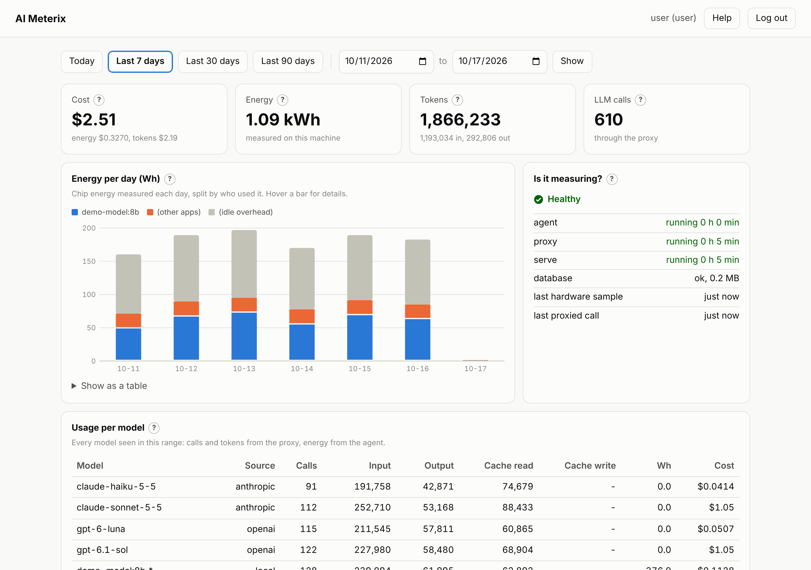
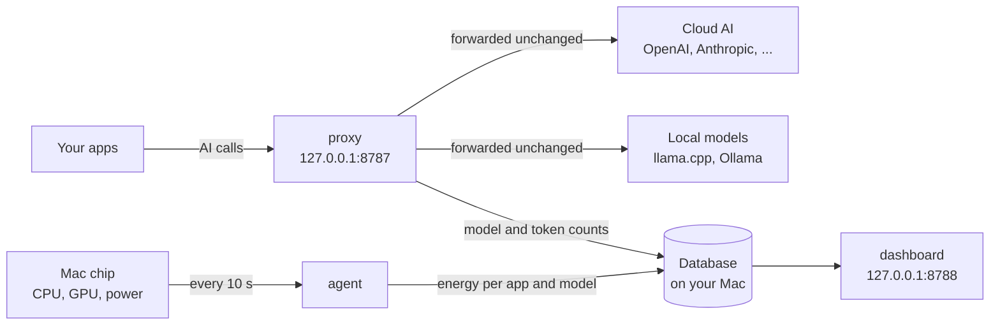

# 📊 AI Meterix

**See what AI really costs on your Mac: energy, tokens and money, in one local dashboard.**

We're excited to ship this small tool to help **developers, indie makers and small teams who run local models (llama.cpp, Ollama) or pay for cloud AI APIs** to **measure the energy their Mac spends on AI, count every token each model uses, and turn both into a clear daily cost.**



## 🚀 Installation

### One line (recommended)

For macOS on Apple Silicon or Intel. No admin password needed.

```bash
curl -fsSL https://github.com/apipas-com/aimeterix/releases/latest/download/install.sh | sh
```

- ✅ Downloads the right build for your Mac from GitHub
- ✅ Checks its SHA-256
- ✅ Installs it in `~/.local` with its own Python
- ✅ Adds `aimeterix` to your PATH
- ✅ Starts AI Meterix and prints the dashboard address

### Installer package

1. Download the `.pkg` for your Mac from the [releases page](https://github.com/apipas-com/aimeterix/releases/latest):
   - Apple Silicon (M1 and later): `ai-meterix-<version>-macos-arm64.pkg`
   - Intel: `ai-meterix-<version>-macos-x86_64.pkg`
2. Double-click it and follow the steps.
3. Start AI Meterix in Terminal:

```bash
aimeterix start
```

> ⚠️ The package is not signed yet. If macOS blocks it, open **System Settings > Privacy & Security** and choose **Open Anyway**.

### From source

Needs [uv](https://docs.astral.sh/uv/).

```bash
git clone https://github.com/apipas-com/aimeterix.git
```

```bash
cd aimeterix
```

```bash
uv run aimeterix start
```

## ▶️ Get started

1. Open the dashboard at http://127.0.0.1:8788/
   - Log in as `user`, password `user`
   - You choose a new password the first time
2. Set your electricity price per kWh:

```bash
aimeterix profile set --rate 0.30
```

3. Point your apps at the proxy instead of the provider, for example `http://127.0.0.1:8787/openai/v1`. Your app keeps its own API key. To see the address for each provider:

```bash
aimeterix providers
```

4. Check that everything is measuring:

```bash
aimeterix health
```

## 🧭 How it works



- 🔀 **proxy:** your apps send their AI calls here. It forwards each call unchanged and notes the model and token counts.
- ⚡ **agent:** every 10 seconds it reads the chip's power and which apps use it, so a local model's energy is measured.
- 📈 **dashboard:** turns the counts into costs with your prices and electricity rate.

## 💾 Where your data lives

- 🗄️ **Database:** `~/Library/Application Support/aimeterix/meter.db` (SQLite; PostgreSQL and DuckDB work too)
- ⚙️ **Settings:** `~/Library/Application Support/aimeterix/aimeterix.yaml`
- 📝 **Logs:** `~/Library/Logs/aimeterix`
- ✅ **Kept:** model names, token counts, timings, energy
- 🚫 **Never kept:** prompts, answers, API keys
- 🏠 **Nothing leaves your Mac** except your own calls to the provider you chose

To print these folders:

```bash
aimeterix paths
```

## 🛠️ Commands

### Run

Start everything in the background (run it again after a restart of the Mac):

```bash
aimeterix start
```

Stop everything:

```bash
aimeterix stop
```

### Check

Is everything running and measuring?

```bash
aimeterix health
```

Today's usage and costs in Terminal:

```bash
aimeterix usage
```

What this Mac can measure:

```bash
aimeterix doctor
```

### Costs and settings

Your electricity price per kWh:

```bash
aimeterix profile set --rate 0.30
```

The AI providers and their proxy addresses:

```bash
aimeterix providers
```

Load public token prices:

```bash
aimeterix prices apply-reference
```

Change the default ports or database before the first start (optional):

```bash
aimeterix init
```

### Remove

Stop and delete all settings and data:

```bash
aimeterix uninstall --purge
```

### Help

Every command and option:

```bash
aimeterix --help
```

The full manual is also in the dashboard: http://127.0.0.1:8788/#help

## 📦 Versions

- **0.1.1 (preview):**
  - Energy metering on Apple Silicon Macs
  - Token counting for 10 cloud providers and local models
  - Daily costs and a local dashboard

All changes are in [CHANGELOG.md](CHANGELOG.md).

### 🔮 Coming soon

- 🐧 Linux and Windows support
- 💡 Advice on what to change to save money
- 📅 A monthly cost forecast
- ✨ General improvements

## 🔒 Security

- Everything listens on 127.0.0.1 only
- No account, no telemetry, no update check
- To report a problem, see [SECURITY.md](SECURITY.md)

## 📄 License

[Apache-2.0](LICENSE). Want to help? See [CONTRIBUTING.md](CONTRIBUTING.md).
